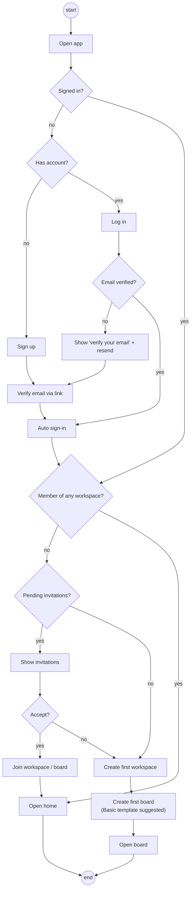

# Activity · First-run onboarding

> Index: [03 · Use cases](../../03-use-cases.md) · Use cases: [Account](../use-case/01-account.md), [Workspace](../use-case/02-workspace.md)

## Notes

- "Pending invitations" means invitations addressed to the user's verified email that are still `pending`. They show even though the user arrived without clicking the invite link.
- The first workspace slug is derived from the user's name (`alex-workspace`), and the user can edit it.
