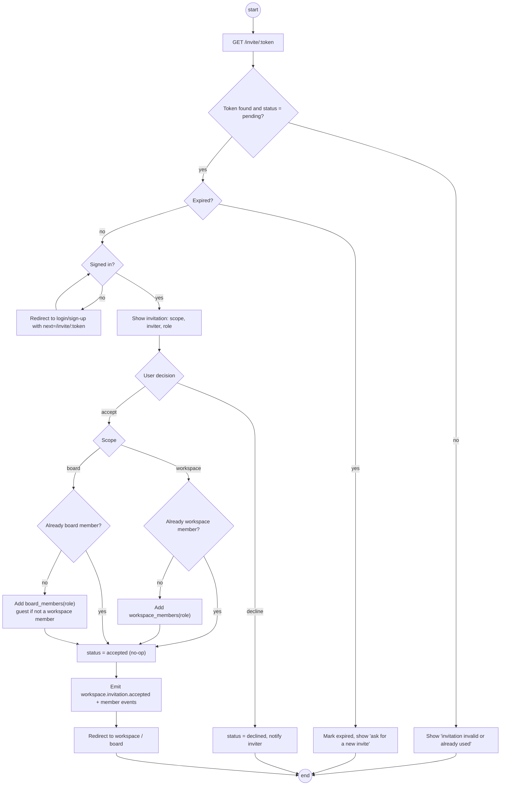

# Activity · Accept invitation

> Index: [03 · Use cases](../../03-use-cases.md) · Use case: [UC-WSP-04/05](../use-case/02-workspace.md#uc-wsp-0405--invite-and-accept) · Sequence: [07](../sequence/07-invite-and-accept-invitation.md) · State: [Invitation](../state/04-invitation.md)

## Notes

- Steps after "accept" run in **one transaction**: lock the invitation row (`FOR UPDATE`), re-check status, insert membership, update the invitation, write the outbox.
- A board invitation always carries the board's `workspace_id`. The invitee becomes a **guest** unless they're already a workspace member.
