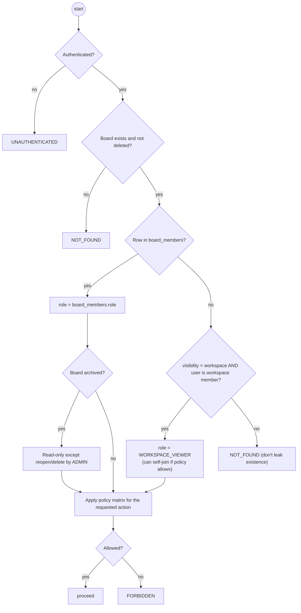

# Activity · Authorization resolution (effective board role)

> Index: [03 · Use cases](../../03-use-cases.md) · Permission matrix: [02 §3](../../02-product-scope.md#3-permission-matrix-mvp) · Cache: [Sequence 21](../sequence/21-cache-aside-and-invalidation.md)

The API runs this before every board-scoped command or query. The result is cached as `perm:board:{boardId}:user:{userId}` for 60 s and invalidated on membership and visibility events.

## Effective roles

| Effective role | Source | Capabilities |
|---|---|---|
| `ADMIN` | `board_members.role` | everything on the board |
| `MEMBER` | `board_members.role` | edit content. Invite only if policy = members |
| `OBSERVER` | `board_members.role` | read. Comment if policy allows |
| `WORKSPACE_VIEWER` | workspace membership + visibility = workspace | read. Comment if policy = workspace. Self-join if enabled |

Every board needs a signed-in user. Public boards aren't in the MVP ([ADR-022](../../11-decisions.md#adr-022)).
