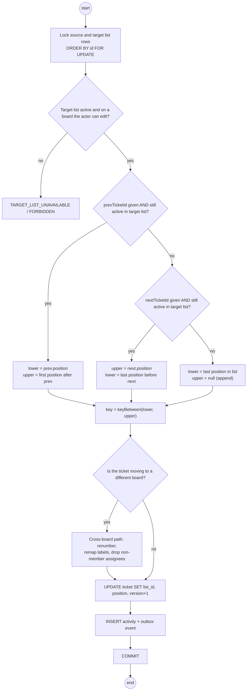

# Activity · Move ticket: server-side position resolution

> Index: [03 · Use cases](../../03-use-cases.md) · Use case: [UC-TKT-04](../use-case/04-list-and-ticket.md#uc-tkt-04--move-ticket-drag-and-drop) · Sequences: [11](../sequence/11-move-ticket-realtime.md), [12](../sequence/12-concurrent-moves.md) · Ordering: [06 · Database §4](../../06-database.md#4-ordering-fractional-indexing)

## Why the server re-resolves neighbours

The client's `prevTicketId`/`nextTicketId` reflect what **it** saw. Another user may have dropped a ticket into the same gap a moment earlier. Locking the list rows serialises writers per list. Re-reading the actual successor of `prev` then guarantees `lower < key < upper` with **no duplicate keys**, even when two users target the same slot ([Sequence 12](../sequence/12-concurrent-moves.md)).

Locks are always taken in `id` order (source and target list) to avoid deadlocks between opposite cross-list moves.
