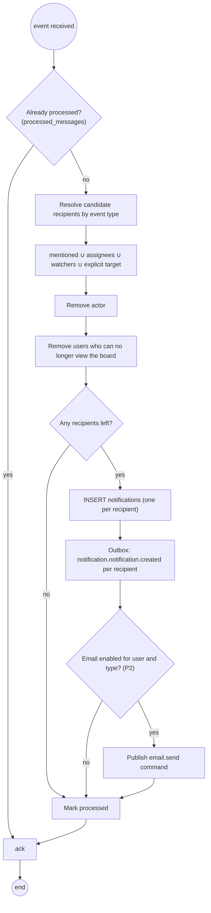

# Activity · Notification fan-out (worker)

> Index: [03 · Use cases](../../03-use-cases.md) · Use case: [UC-TKT-12](../use-case/05-collaboration.md#uc-tkt-12--comment-with-mention) · Sequence: [15](../sequence/15-comment-mention-notification.md) · State: [Notification](../state/12-notification.md)

## Recipient rules per event

| Event | Notification type | Recipients |
|---|---|---|
| `collab.comment.created` | `COMMENT_MENTION` / `COMMENT_ON_WATCHED` | mentioned users (mention wins) · watchers · assignees |
| `board.ticket.assignee_added` | `ASSIGNED_TO_TICKET` | the added assignee |
| `board.ticket.moved` | `TICKET_MOVED` | watchers |
| `board.ticket.dates_changed` | `DUE_DATE_CHANGED` | watchers · assignees |
| `board.ticket.due_soon` (P2) | `DUE_SOON` | assignees · watchers |
| `board.member.added` | `ADDED_TO_BOARD` | the added member |
| `workspace.invitation.created` | `INVITATION_RECEIVED` | existing user with that email |
| `workspace.member.joined` | `INVITATION_ACCEPTED` | inviter |

Every type always excludes the actor. A user gets **one** notification per event, even when several rules match. The highest-priority type wins.
