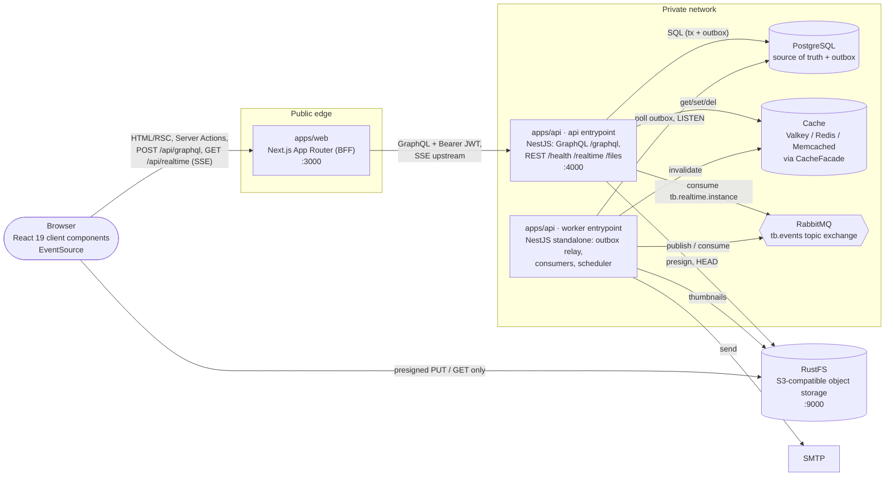

# Architecture · Containers (C4 level 2)

> Index: [04 · Architecture §2](../../04-architecture.md#2-containers-c4-level-2) · Runtime services: [10-compose-services](./10-compose-services.md)

Container responsibilities and the request-path table: [04 · Architecture §2](../../04-architecture.md#2-containers-c4-level-2).

The browser never talks to the API directly. The only bypass of the BFF is presigned object-storage URLs.
