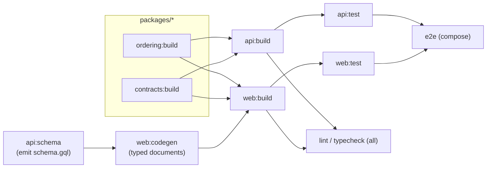

# Architecture · Turborepo task graph

> Index: [04 · Architecture §3](../../04-architecture.md#3-monorepo-layout-turborepo--pnpm-workspaces)

## Notes

- `api:schema` boots the Nest GraphQL module in "schema only" mode and writes `apps/api/schema.gql` (committed). CI fails if the committed schema differs from the generated one.
- `web:codegen` reads that file, so the web build never needs a running API.
- `@tb/ui` has no build step. `apps/web` compiles it through `transpilePackages`, so it isn't a node in this graph.
