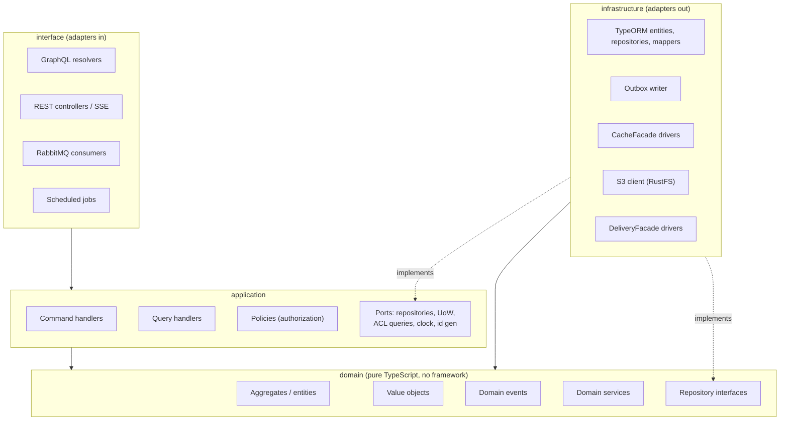

# Architecture · Backend layering (hexagonal, per bounded context)

> Index: [04 · Architecture §4.2](../../04-architecture.md#42-layering-and-dependency-rule)

Solid arrow = "depends on". Dotted = "implements". Nothing points *out of* `domain`.
