# Architecture · Command pipeline (one mutation, end to end inside the API)

> Index: [04 · Architecture §4.4](../../04-architecture.md#44-command-pipeline-component-view) · Concrete example: [Sequence 11](../sequence/11-move-ticket-realtime.md)

```mermaid
flowchart LR
  req["GraphQL mutation"] --> guard["JwtAuthGuard<br/>(verifies access token)"]
  guard --> pipe["ValidationPipe<br/>(input DTO)"]
  pipe --> resolver["Resolver<br/>maps input → Command"]
  resolver --> h["CommandHandler.execute(command)<br/>(injected directly, no bus)"]
  h --> uow["UnitOfWork.run(work)"]
  subgraph TX["single DB transaction"]
    repoL["Repository.load (FOR UPDATE where needed)"]
    pol["Policy.assert(actor, action, resource)"]
    aggM["Aggregate method(now) → raises DomainEvents"]
    repoS["Repository.save: versioned UPDATE → markPersisted → uow.track"]
    actW["Activity recorder (in-process handler)"]
    obW["Outbox writer"]
  end
  uow --> repoL --> pol --> aggM --> repoS --> actW --> obW
  obW --> commit["COMMIT"]
  commit --> after["after-commit hooks:<br/>cache invalidation, NOTIFY outbox"]
  after --> resp["Payload DTO"]
```

## Notes

- **No command bus.** Resolvers, controllers and consumers inject the handler class and call `execute()`.
- **`UnitOfWork.run(work)`** runs the work in one transaction. A nested `run()` joins the outer one. Repositories call `uow.track(aggregate)` after a successful save, which hands over the aggregate's events. Handlers call `uow.record(event)` for an event that no aggregate raises (`identity.user.signup_attempted`). If the work throws, everything rolls back, events included.
- **The policy check runs inside the transaction**, after loading, because it needs the loaded resource (board role, visibility).
- **Planned, not built yet:** after-commit hooks, and retrying commutative commands on `ConcurrencyError` ([04 §4.4](../../04-architecture.md#44-command-pipeline-component-view)).
