# Architecture · Command pipeline (one mutation, end to end inside the API)

> Index: [04 · Architecture §4.4](../../04-architecture.md#44-command-pipeline-component-view) · Concrete example: [Sequence 11](../sequence/11-move-ticket-realtime.md)

```mermaid
flowchart LR
  req["GraphQL mutation"] --> guard["JwtAuthGuard<br/>(verifies access token)"]
  guard --> pipe["ValidationPipe<br/>(input DTO)"]
  pipe --> resolver["Resolver<br/>maps input → Command"]
  resolver --> bus["CommandBus"]
  bus --> h["CommandHandler"]
  h --> pol["Policy.assert(actor, action, resource)"]
  pol --> uow["UnitOfWork.run(tx)"]
  subgraph TX["single DB transaction"]
    repoL["Repository.load (FOR UPDATE where needed)"]
    aggM["Aggregate method → raises DomainEvents"]
    repoS["Repository.save (version check)"]
    actW["Activity recorder (in-process handler)"]
    obW["Outbox writer"]
  end
  uow --> repoL --> aggM --> repoS --> actW --> obW
  obW --> commit["COMMIT"]
  commit --> after["after-commit hooks:<br/>cache invalidation, NOTIFY outbox"]
  after --> resp["Payload DTO"]
```

