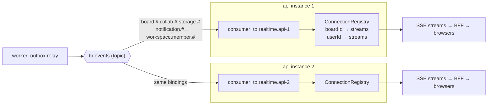

# Architecture · Realtime fan-out (RabbitMQ → API instances → SSE)

> Index: [04 · Architecture §4.6](../../04-architecture.md#46-realtime-design-summary) · Sequences: [11](../sequence/11-move-ticket-realtime.md), [19](../sequence/19-sse-connection-lifecycle.md) · Client state: [15](../state/15-sse-client-connection.md) · Scale path: [12](./12-realtime-scale-path.md)

## Notes

- Queues `tb.realtime.<instanceId>` are **classic, exclusive, auto-delete**: they vanish with the instance, and nothing piles up for dead instances.
- Every instance receives every realtime-relevant event and filters in memory. That's fine up to thousands of events per second. Scale path: add `boardId` to the routing key and bind dynamically per board with local subscribers.
- The registry also indexes by `sessionId` so `identity.session.revoked` can close that session's streams.
