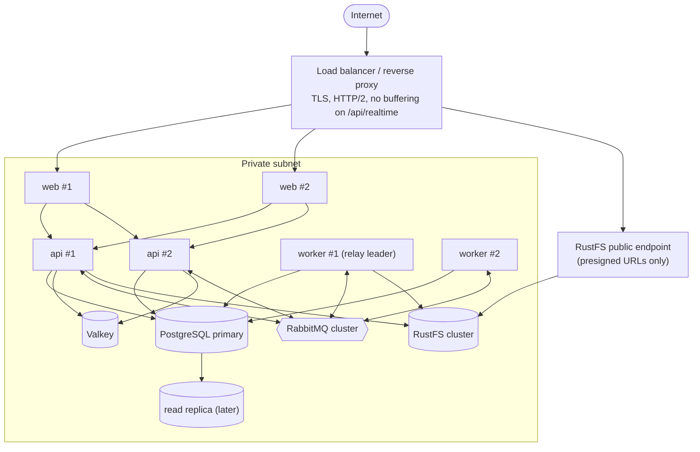

# Architecture · Deployment view (production sketch)

> Index: [04 · Architecture §7](../../04-architecture.md#7-deployment-view-production-sketch)

## Notes

- SSE needs **proxy buffering off** and long idle timeouts (≥ 60 s, with 25 s heartbeats) on every hop.
- `web` → `api` stays on the private network. The API is never exposed publicly.
- No sticky sessions needed. Any API instance can serve any board stream.
- This is a target sketch. No hosting exists yet: services run on Docker first and move to Kubernetes later ([ADR-024](../../11-decisions.md#adr-024)).
