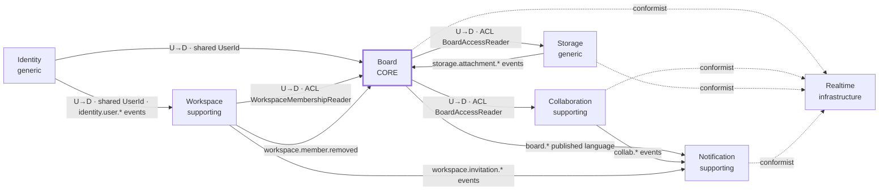

# Architecture · DDD context map

> Index: [05 · Domain model §1](../../05-domain-model.md#1-strategic-design)

## Relationship legend

| Notation | Meaning |
|---|---|
| **U→D** | Upstream → downstream. The downstream adapts to the upstream's model |
| **ACL** | Anti-corruption layer. The downstream declares a port (e.g. `WorkspaceMembershipReader`) in its `application/ports` and implements it in its own `infrastructure/acl` with read-only SQL over the upstream's tables. It never imports upstream code |
| **published language** | Versioned integration events (`<context>.<aggregate>.<event>` + JSON payload) defined in [05 §5](../../05-domain-model.md#5-domain-events-catalog) |
| **conformist** | Realtime takes the events as-is and only projects them into client event shapes |
| **shared UserId** | Every context references users by id only. Display data (name, avatar) is read through a `UserDirectory` port, cached |

## Synchronous vs asynchronous

| Interaction | Mode | Why |
|---|---|---|
| "Is user X a member of workspace W?" (Board) | sync ACL read | Needed inside a command's authorization step |
| "Can user X see ticket T?" (Collaboration, Storage) | sync ACL read | Same |
| Activity recording (Board → Collaboration) | in-process, same transaction | Feed must match state instantly ([ADR-011](../../11-decisions.md#adr-011)) |
| Notifications, emails, thumbnails, realtime | async via outbox → RabbitMQ | Decoupled, retryable, doesn't slow the request |
