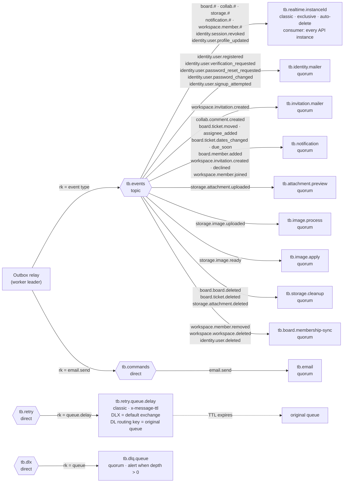

# Architecture · RabbitMQ topology

> Index: [10 · Infrastructure §5](../../10-infrastructure.md#5-messaging-rabbitmq) · Flows: [Sequence 18](../sequence/18-outbox-relay-and-consumers.md) · States: [Message consumption](../state/16-message-consumption.md)

## Consumers

| Queue | Process | Handler | Prefetch |
|---|---|---|---|
| `tb.realtime.<instanceId>` | api | project to client events, push to the local SSE registry | 200 |
| `tb.identity.mailer` | worker | issue verification/reset token, send identity emails | 10 |
| `tb.invitation.mailer` | worker | issue invitation token, send the invitation email | 10 |
| `tb.notification` | worker | recipient resolution, `notifications` rows, `email.send` commands | 20 |
| `tb.email` | worker | render the localised template, send through `DeliveryFacade` | 5 |
| `tb.attachment.preview` | worker | thumbnails with `sharp` | 2 |
| `tb.image.process` | worker | re-encode avatars and logos into `tb-public` | 2 |
| `tb.image.apply` | worker | run `SetAvatar` or `SetWorkspaceLogo`, delete the previous object | 5 |
| `tb.storage.cleanup` | worker | batch-delete objects in RustFS | 5 |
| `tb.board.membership-sync` | worker | remove board memberships after workspace/user removal | 10 |
