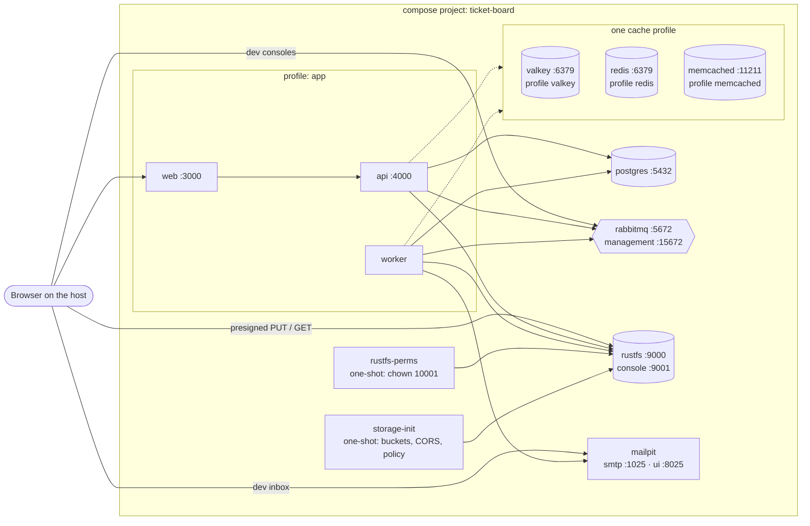

# Architecture · Docker Compose services (development)

> Index: [10 · Infrastructure §2](../../10-infrastructure.md#2-docker-compose-development)

Dashed = whichever cache profile is active. Infra services have no profile, so they always start. App services are in the `app` profile, which lets you run them on the host instead.
