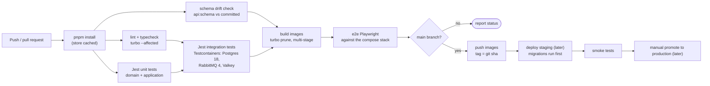

# Architecture · CI/CD pipeline

> Index: [10 · Infrastructure §9](../../10-infrastructure.md#9-cicd)

| Gate | Fails the build when |
|---|---|
| lint | import-boundary violations (domain importing infrastructure, cross-context imports) |
| schema drift | `schema.gql` changed without being committed, or a breaking change without the `breaking-api` label |
| integration | a migration fails on a fresh DB, or an outbox/consumer contract test fails |
| e2e | the critical journeys fail: sign-up → board → move ticket seen by a second browser |
