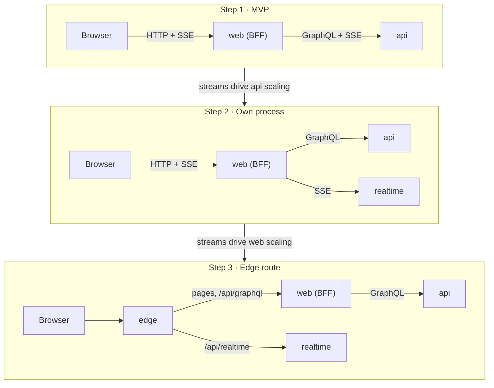

# Architecture · Realtime scale path

> Index: [04 · Architecture §4.6](../../04-architecture.md#46-realtime-design-summary) · Decision: [ADR-026](../../11-decisions.md#adr-026) · Today's flow: [Realtime fan-out](./06-realtime-fanout.md), [Sequence 19](../sequence/19-sse-connection-lifecycle.md)

## Notes

- **Step 1 is the design.** Steps 2 and 3 are options, and each needs its own ADR when its trigger appears.
- `realtime` is a third entrypoint in the same codebase, not a new service. It runs the `realtime` module and consumes the same `tb.events` bindings as `api` does today.
- **`api` is never reachable from the browser.** In step 3 only `/api/realtime` skips Next.js, and it stays on the app's origin.
- The stream contract in [09 · API §5](../../09-api-contract.md#5-realtime-sse-contract) doesn't change at any step, so clients don't need a new event format.
