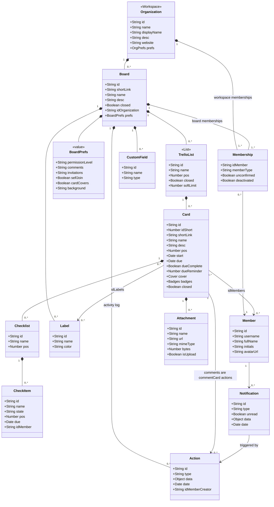

# Class · Trello object model (reference, as investigated)

> Index: [05 · Domain model](../../05-domain-model.md) · Analysis: [01 · Trello analysis](../../01-trello-analysis.md)
>
> This is **Trello's** model, using field names from its REST API. It's the reference we cloned from, not our domain model. For ours, see [04-board](./04-board.md).

## Observations that shaped our model

| Trello fact | Consequence for Ticket Board |
|---|---|
| `memberType` exists on both org and board memberships | Two independent role tables: `workspace_members`, `board_members` |
| Labels belong to the board | `labels.board_id`. Cross-board moves remap labels |
| `pos` is a float | We use string fractional keys ([ADR-006](../../11-decisions.md#adr-006)) |
| `idShort` per board + `shortLink` | `tickets.number` (per-board sequence) + `short_id` |
| Comments are actions | Activity feed and comments share one timeline. Comments still get their own table so they can be edited |
| `badges` precomputed | Board snapshot query returns counts per ticket |
