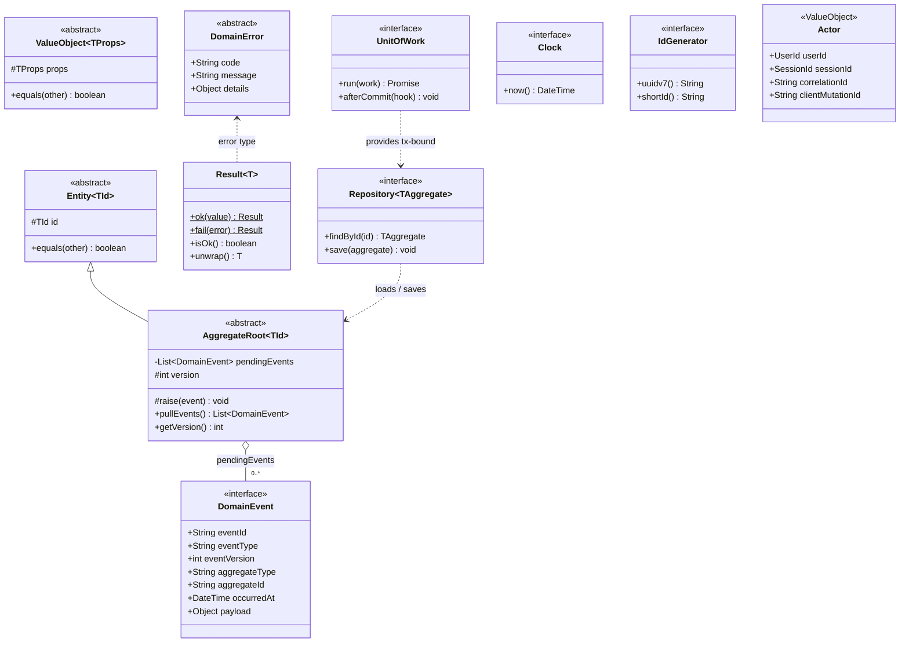

# Class · Shared kernel (`apps/api/src/shared/kernel`)

> Index: [05 · Domain model §2](../../05-domain-model.md#2-tactical-building-blocks)

## Conventions

- **Pure TypeScript.** No decorators, no ORM types, no Nest imports in anything shown here.
- Aggregates **raise** events. The `UnitOfWork` **pulls** them after `save()` and hands them to the activity recorder and the outbox writer inside the same transaction.
- `Actor` travels from the resolver into every command. Its `correlationId` and `clientMutationId` end up in outbox metadata and realtime events.
- `DomainError.message` is a developer-facing English fallback. Users see text translated from `code` at the interface layer ([12 · Internationalisation](../../12-internationalisation.md)).
- IDs are branded string types (`type TicketId = string & { __brand: 'TicketId' }`) to stop mixing ids of different aggregates.
