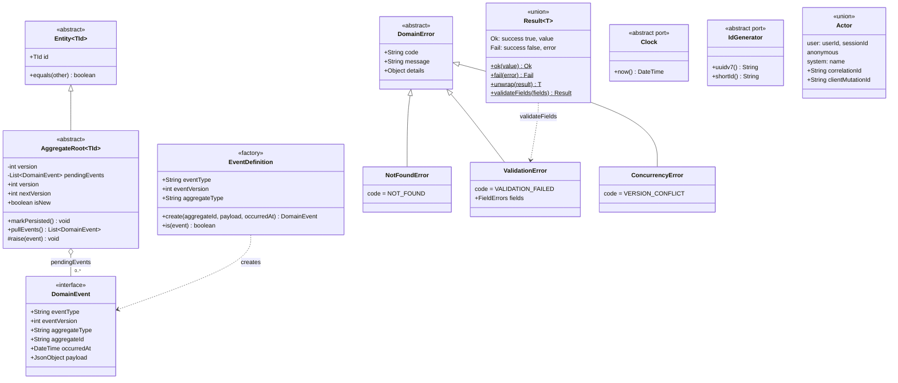

# Class · Shared kernel (`apps/api/src/shared/kernel`)

> Index: [05 · Domain model §2](../../05-domain-model.md#2-tactical-building-blocks)

## Conventions

- **Pure TypeScript.** No decorators, no ORM types, no Nest imports in anything shown here.
- **Two factories per aggregate.** `create`-style methods (`User.register`) validate, start at version 0 and raise the created event. `rehydrate` rebuilds stored state and raises nothing. Only repositories call `rehydrate`.
- **Version.** `version` is the version the aggregate was loaded at. A repository writes `UPDATE … WHERE version = :version`, then calls `markPersisted()`. 0 rows means `ConcurrencyError` (`VERSION_CONFLICT`). One save bumps the version by one, however many events the command raised.
- Aggregates **raise** events. The `UnitOfWork` **pulls** them after `save()` and hands them to the activity recorder and the outbox writer inside the same transaction.
- **Domain events have no id.** The outbox writer assigns the event id (UUIDv7, also the AMQP `message_id`) and adds `aggregate.version` and `metadata` when it builds the [envelope](../../05-domain-model.md#6-integration-event-envelope). Aggregate methods take `now` from the handler, so the domain never reads a clock.
- **Events are declared with `defineEvent`**, which rejects non-JSON payload fields (`Date`, `Map`, functions) at compile time.
- **Throw vs Result.** Value-object factories return `Result<Vo, code>`, and `validateFields` collects them into one `ValidationError`. Aggregate methods throw a `DomainError` when an invariant is broken.
- **Ports:** `Clock` and `IdGenerator` are abstract classes, so the class is both the type and the Nest DI token. `UnitOfWork` (in `shared/application`) is an interface with a separate `UNIT_OF_WORK` token, injected with `@Inject(UNIT_OF_WORK)`.
- `Actor` travels from the resolver into every command. `user` is a signed-in request, `anonymous` a public auth flow (`register`), `system` the worker or a scheduler. `correlationId` and `clientMutationId` end up in outbox metadata and realtime events. The envelope's `actorId` is the user id, or `null` for the other kinds.
- `DomainError.message` is a developer-facing English fallback. Users see text translated from `code` at the interface layer ([12 · Internationalisation](../../12-internationalisation.md)). `ValidationError.fields` maps field names to error codes, not messages.
- IDs are plain `string` aliases for now (`type UserId = string`). Branded types, which stop ids of different aggregates being mixed up, may come later. Only ids used by several contexts (`UserId`, `SessionId`) live in the kernel.
- **Not in the kernel:** each context declares its own repository as an abstract class in `domain/repositories/` ([05 §2](../../05-domain-model.md#2-tactical-building-blocks)). `UnitOfWork` and the `CommandHandler` / `QueryHandler` types live in `shared/application` ([Command pipeline](../architecture/05-command-pipeline.md)).
