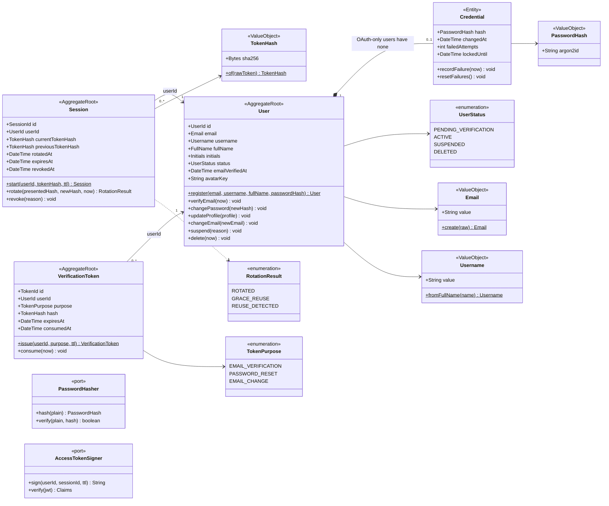

# Class · Identity context

> Index: [05 · Domain model §3.1](../../05-domain-model.md#31-identity) · Tables: [ERD 01](../erd/01-identity-workspace.md) · States: [User](../state/01-user-account.md), [Session](../state/02-session.md), [Token](../state/03-verification-token.md)

## Invariants

| Invariant | Enforced by |
|---|---|
| Email unique (case-insensitive) | `citext UNIQUE` + `EmailTaken` domain error |
| Username: `^[a-z0-9_]{3,30}$`, unique | `Username` VO + DB constraint |
| Only `ACTIVE` users can log in | `LoginHandler` |
| A raw token is never persisted. Only its SHA-256 | `TokenHash` VO |
| Issuing a new token of the same purpose invalidates older unconsumed ones | `VerificationToken.issue` + repository |
| Refresh reuse outside the 10 s grace window revokes the session | `Session.rotate` |
| Password change revokes every other session | `ChangePasswordHandler` |
