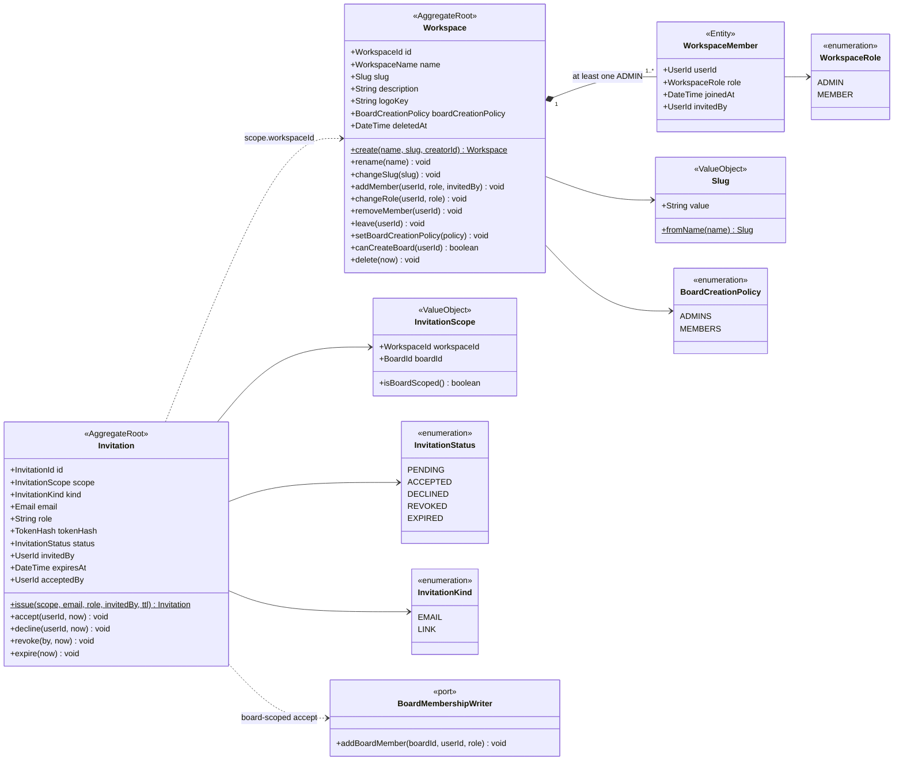

# Class · Workspace context

> Index: [05 · Domain model §3.2](../../05-domain-model.md#32-workspace) · Tables: [ERD 01](../erd/01-identity-workspace.md) · States: [Invitation](../state/04-invitation.md), [Membership](../state/05-workspace-membership.md)

## Invariants

| Invariant | Enforced by |
|---|---|
| ≥ 1 `ADMIN` at all times | `Workspace.changeRole/removeMember/leave` → `LastAdminError` |
| Slug `^[a-z0-9-]{3,50}$`, globally unique | `Slug` VO + `citext UNIQUE` |
| One pending email invitation per (scope, email) | partial unique index |
| Accept only when `PENDING` and not expired | `Invitation.accept` |
| Board-scoped invite role ∈ {ADMIN, MEMBER, OBSERVER}. Workspace-scoped ∈ {ADMIN, MEMBER} | `Invitation.issue` |

**Accepting a board-scoped invitation** crosses into the Board context. The `AcceptInvitationHandler` calls the `BoardMembershipWriter` port inside the same transaction. It's implemented by the Board module's application service, not by direct table writes, so Board invariants still apply.
