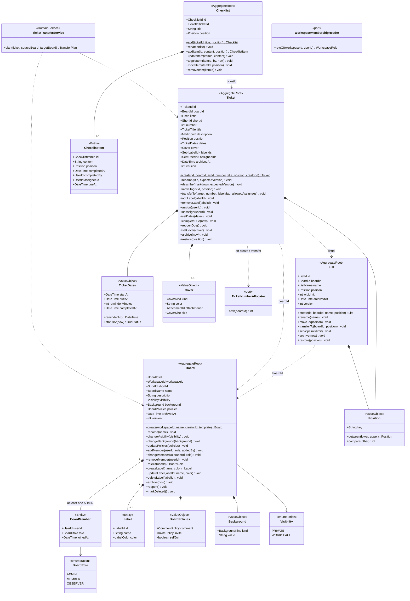

# Class · Board context (core domain)

> Index: [05 · Domain model §3.3](../../05-domain-model.md#33-board-core) · Tables: [ERD 02](../erd/02-board-core.md) · States: [Board](../state/06-board.md), [List](../state/07-list.md), [Ticket](../state/08-ticket.md), [Due status](../state/09-ticket-due-status.md), [Checklist item](../state/11-checklist-item.md)

## Why the aggregates are split this way

| Decision | Reason |
|---|---|
| **Tickets aren't inside Board** | A board can have thousands of tickets. Loading them all to move one would be slow and would serialise every write on the board row |
| **List is its own aggregate** | Reordering lists shouldn't conflict with editing tickets. The list row doubles as the **lock** that serialises position changes inside that list |
| **Checklist is its own aggregate** | Toggling items (frequent, concurrent) shouldn't bump the ticket's version and cause conflicts with description edits |
| **Labels and members inside Board** | Small bounded sets with invariants (last admin, label belongs to board) |
| **Ticket numbers via a port** | `UPDATE boards SET ticket_seq = ticket_seq + 1 RETURNING ticket_seq` is atomic and doesn't load or version the Board aggregate |

## Invariants

| Invariant | Enforced by |
|---|---|
| ≥ 1 board `ADMIN` | `Board.changeMemberRole/removeMember` → `LastBoardAdminError` |
| A ticket's labels belong to the ticket's board | `AddLabelHandler` checks `board.hasLabel(labelId)`. Cross-board transfer remaps |
| Assignees are board members | `AssignHandler` checks `board.roleOf(userId) ∈ {ADMIN, MEMBER, OBSERVER}` |
| No content mutation on an archived board | handlers check `board.isArchived()` (read-only except reopen/delete) |
| Board delete requires archived | `Board.markDeleted` |
| Unique active position per list | list row lock + `Position.between` with real neighbours + partial unique index |
| `startAt ≤ dueAt` when both set | `TicketDates` VO |
