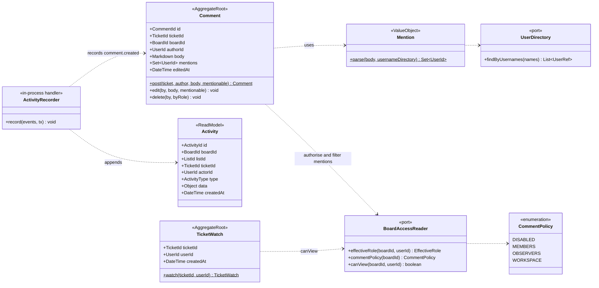

# Class · Collaboration context (comments, activity, watching)

> Index: [05 · Domain model §3.4](../../05-domain-model.md#34-collaboration) · Tables: [ERD 03](../erd/03-collaboration-storage-notification.md) · Sequence: [15](../sequence/15-comment-mention-notification.md)

## Rules

- **Activity is a projection**, not an aggregate. Domain events from any context are mapped to `Activity` rows by `ActivityRecorder` **in the same transaction** ([ADR-011](../../11-decisions.md#adr-011)). Its `data` holds a **snapshot** of names at the time ("moved from *To Do* to *Doing*"), so history stays readable after renames and deletes.
- Only mentions of users who can view the board are stored. Mentioning someone doesn't grant access.
- Editing is author-only. Deleting is author or board `ADMIN`. Comments are hard-deleted and leave a `comment.deleted` activity.
- Watching is implicit for the ticket creator, assignees and commenters (P2 setting). For the MVP it's explicit plus the creator.
