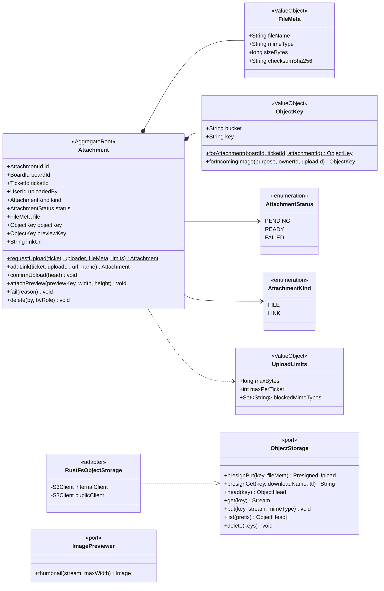

# Class · Storage context (attachments on RustFS)

> Index: [05 · Domain model §3.5](../../05-domain-model.md#35-storage) · Tables: [ERD 03](../erd/03-collaboration-storage-notification.md) · State: [Attachment](../state/10-attachment.md) · Sequences: [16](../sequence/16-attachment-upload.md), [17](../sequence/17-attachment-download.md)

## Notes

- **Two S3 clients.** `internalClient` uses `http://rustfs:9000` for HEAD/GET/PUT/DELETE inside the network. `publicClient` uses the browser-reachable endpoint and **only signs URLs**, because the SigV4 signature covers the `Host` header.
- The object key is built from ids only: `boards/{boardId}/tickets/{ticketId}/{attachmentId}`. The file name stays in `attachments.file_name` and is applied at download ([13 · File uploads](../../13-file-uploads.md)).
- Cross-board ticket moves update `attachments.board_id` **only**. Object keys never change, so no copy is needed.
- When a ticket or board is deleted, `board.ticket.deleted` / `board.board.deleted` → the worker deletes the objects in batches.
