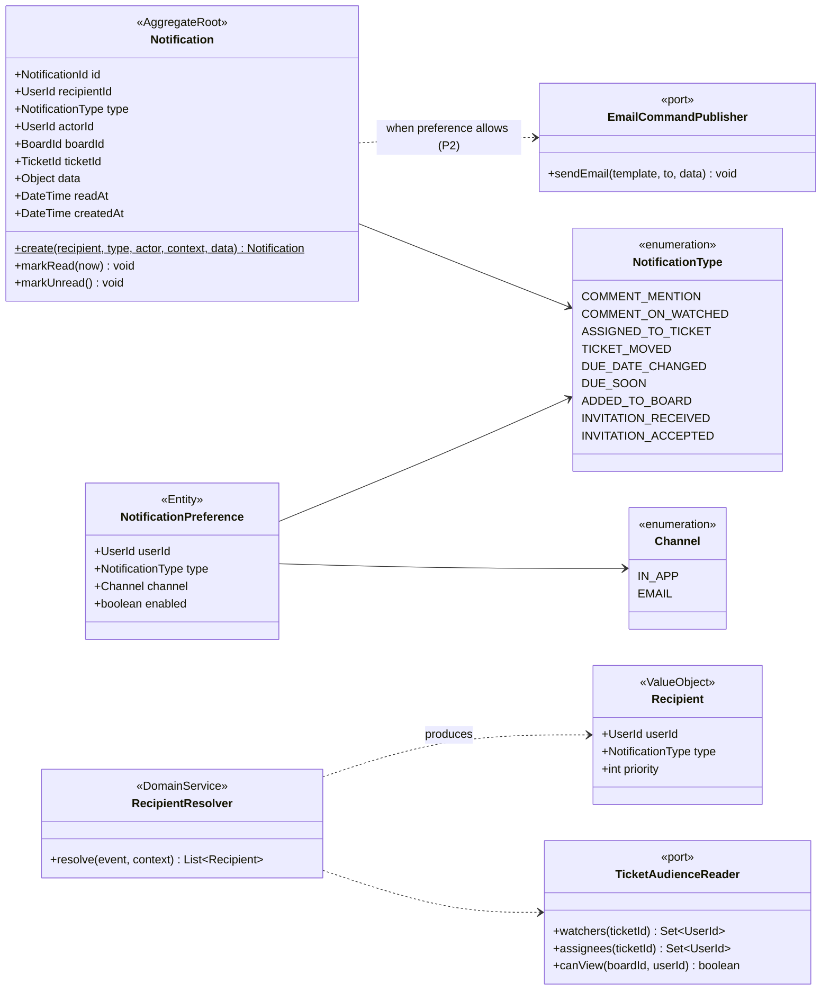

# Class · Notification context

> Index: [05 · Domain model §3.6](../../05-domain-model.md#36-notification) · Tables: [ERD 03](../erd/03-collaboration-storage-notification.md) · State: [Notification](../state/12-notification.md) · Activity: [Fan-out](../activity/05-notification-fanout.md)

## Rules

- **One notification per (event, recipient).** When several rules match, the highest-priority type wins (mention > assigned > watched).
- **Idempotent.** The consumer records `(consumer, messageId)` in `processed_messages` in the same transaction as the inserts.
- Notifications older than 90 days and read are purged (P2 job).
