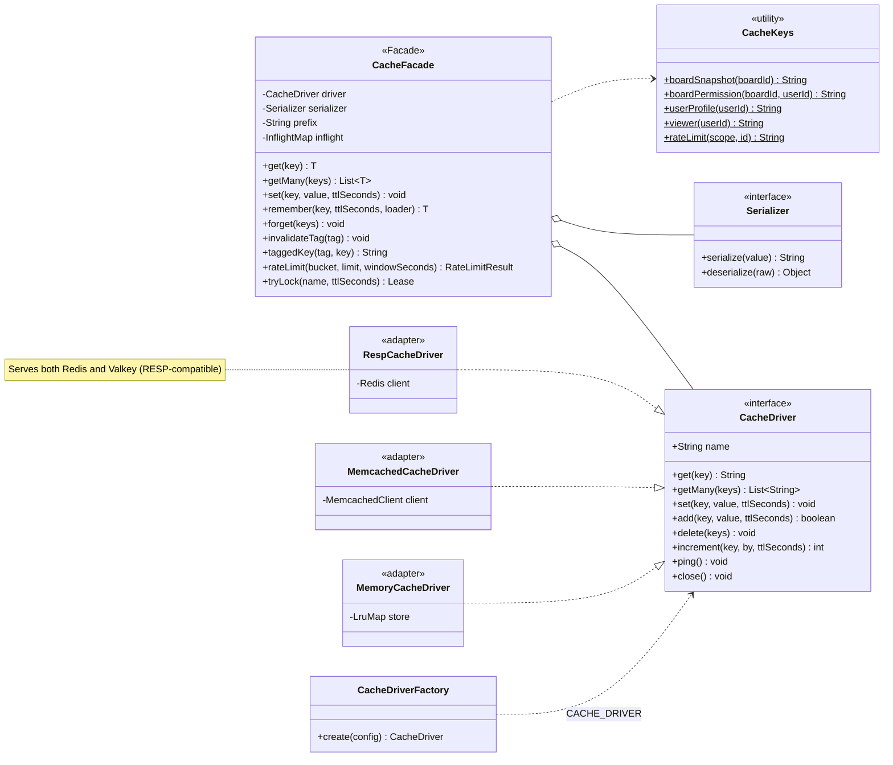

# Class · Cache facade (Redis / Valkey / Memcached)

> Index: [10 · Infrastructure §4](../../10-infrastructure.md#4-cache-facade) · Decision: [ADR-008](../../11-decisions.md#adr-008) · Flow: [Sequence 21](../sequence/21-cache-aside-and-invalidation.md)

## Pattern roles

- **Facade:** `CacheFacade` is the **only** cache API that application code sees. It offers higher-level operations (`remember`, tags, rate limit, lock) built from a minimal driver contract.
- **Adapter / Strategy:** each `CacheDriver` adapts one client library to the contract. `CacheDriverFactory` picks one from `CACHE_DRIVER=redis|valkey|memcached|memory`.
- The driver contract is the **lowest common denominator** of Redis, Valkey and Memcached: no pub/sub, no key scans, no Lua. Anything needing those (realtime fan-out) goes through RabbitMQ instead.
