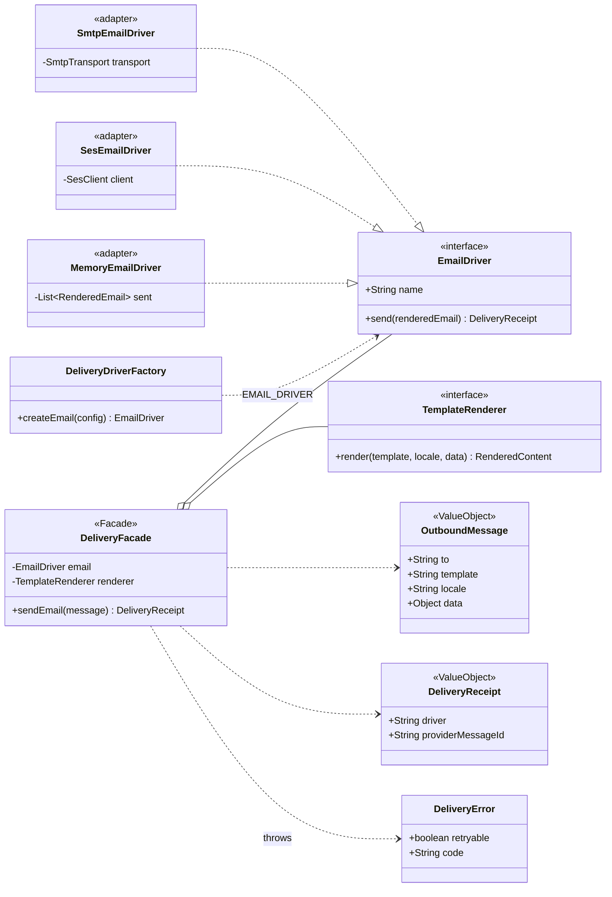

# Class · Delivery facade (email)

> Index: [10 · Infrastructure §11](../../10-infrastructure.md#11-delivery-facade) · Decisions: [ADR-021](../../11-decisions.md#adr-021), [ADR-025](../../11-decisions.md#adr-025) · Consumer: `tb.email` in [RabbitMQ topology](../architecture/09-rabbitmq-topology.md)

## Pattern roles

- **Facade:** `DeliveryFacade` is the only sending API that application code sees. It renders the template in the recipient's locale, then hands the result to a driver.
- **Adapter / Strategy:** each driver wraps one provider. `DeliveryDriverFactory` picks one from `EMAIL_DRIVER`.
- **Worker only.** The API never sends anything itself. It raises events, and the worker's consumers call the facade.
- `DeliveryError.retryable` decides whether a consumer takes the retry ladder or goes to the DLQ ([State 16](../state/16-message-consumption.md)).

Driver status: [10 · Infrastructure §11](../../10-infrastructure.md#11-delivery-facade).
