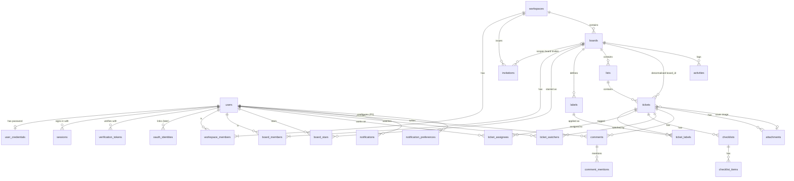

# ERD · Overview (relationships only)

> Index: [06 · Database](../../06-database.md) · Detailed ERDs: [01 Identity and workspace](./01-identity-workspace.md) · [02 Board core](./02-board-core.md) · [03 Collaboration, storage, notification](./03-collaboration-storage-notification.md) · [04 Infrastructure](./04-infrastructure-tables.md)

## Table groups

| Group | Tables | Context |
|---|---|---|
| Identity | `users`, `user_credentials`, `sessions`, `verification_tokens`, `oauth_identities` (later) | Identity |
| Workspace | `workspaces`, `workspace_members`, `invitations` | Workspace |
| Board | `boards`, `board_members`, `board_stars`, `labels`, `lists`, `tickets`, `ticket_labels`, `ticket_assignees`, `checklists`, `checklist_items` | Board |
| Collaboration | `comments`, `comment_mentions`, `comment_reactions` (P2), `ticket_watchers`, `activities` | Collaboration |
| Storage | `attachments` | Storage |
| Notification | `notifications`, `notification_preferences` (P2) | Notification |
| Infrastructure | `outbox_events`, `processed_messages` | shared |

Each context **owns** its tables: only that context's repositories write them. Other contexts read them only through ACL readers ([context map](../architecture/08-context-map.md)).
