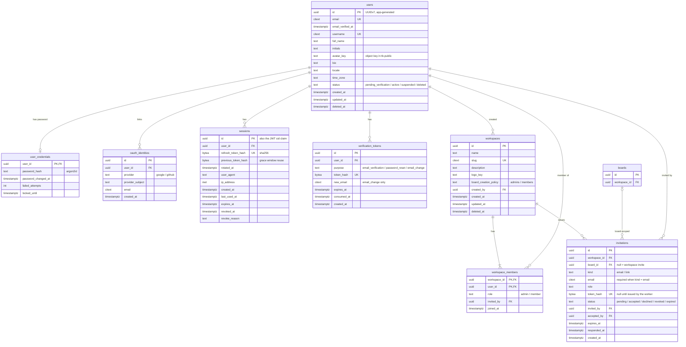

# ERD · Identity and workspace

> Index: [06 · Database §3](../../06-database.md#3-ddl-draft-postgresql-18) · Classes: [Identity](../class/02-identity.md), [Workspace](../class/03-workspace.md)

`boards` is shown as a stub. Its full definition is in [ERD 02](./02-board-core.md).
