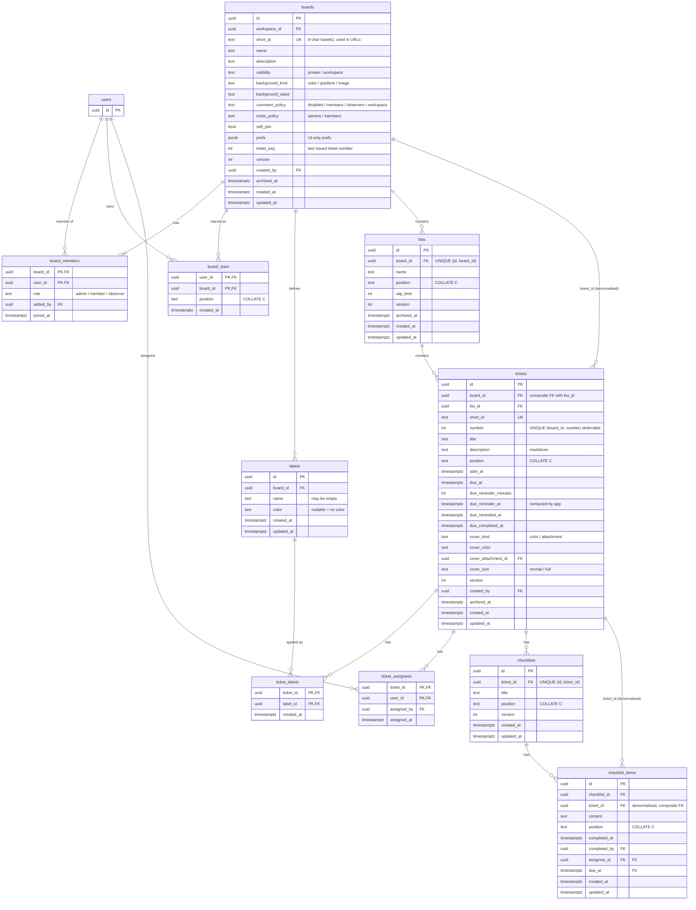

# ERD · Board core (boards, lists, tickets, checklists)

> Index: [06 · Database §3](../../06-database.md#3-ddl-draft-postgresql-18) · Class: [Board context](../class/04-board.md)

## Integrity tricks worth noting

- **`tickets (list_id, board_id) → lists (id, board_id)`** composite FK with `ON UPDATE CASCADE`. The denormalised `board_id` can never disagree with the list's board, and moving a list to another board drags its tickets along.
- **`checklist_items (checklist_id, ticket_id) → checklists (id, ticket_id)`**. Same idea, so badge counts can group by `ticket_id` without a join.
- **`UNIQUE (board_id, number) DEFERRABLE INITIALLY DEFERRED`** lets a cross-board transfer renumber inside one transaction.
- **Partial unique `(list_id, position) WHERE archived_at IS NULL`**. Archived rows keep their old key and get a fresh one on restore.
