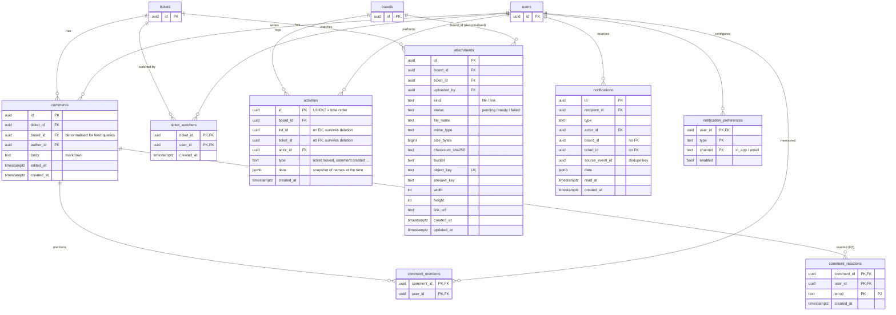

# ERD · Collaboration, storage, notification

> Index: [06 · Database §3](../../06-database.md#3-ddl-draft-postgresql-18) · Classes: [Collaboration](../class/05-collaboration.md), [Storage](../class/06-storage.md), [Notification](../class/07-notification.md)

## Notes

- `activities.list_id` / `ticket_id` and `notifications.board_id` / `ticket_id` intentionally have **no FK**. History and notifications must survive deletion ("X deleted ticket #42"). The `data` snapshot holds the display names.
- `notifications (recipient_id, source_event_id)` is **unique**. A redelivered RabbitMQ message can't create duplicates, even without the inbox table.
