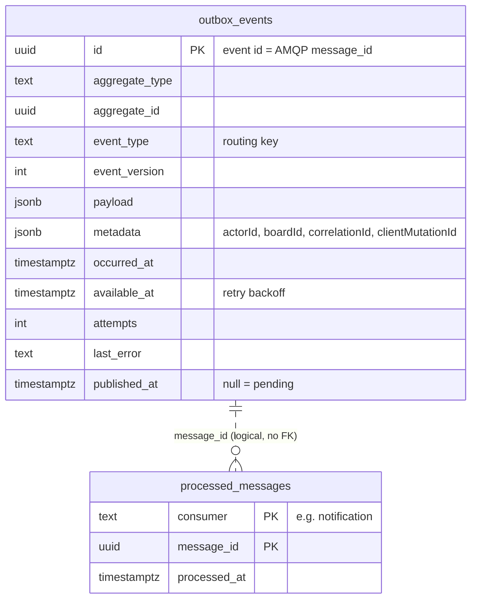

# ERD · Infrastructure tables (outbox, inbox)

> Index: [06 · Database §3](../../06-database.md#3-ddl-draft-postgresql-18) · Flow: [Sequence 18](../sequence/18-outbox-relay-and-consumers.md) · State: [Outbox event](../state/13-outbox-event.md)

## Notes

- A statement-level `AFTER INSERT` trigger on `outbox_events` runs `pg_notify('outbox_new', '')`. Notifications are delivered **on commit**, so the relay wakes up only for committed events.
- The relay reads `WHERE published_at IS NULL AND available_at <= now() ORDER BY id LIMIT 200 FOR UPDATE SKIP LOCKED`.
- `processed_messages` is the **inbox** for idempotent consumers. The consumer inserts `(consumer, message_id)` in the same transaction as its side effects. On a conflict, it skips and acks.
- Retention: published outbox rows are purged after 7 days. Inbox rows after 14 days (longer than the maximum redelivery window).
