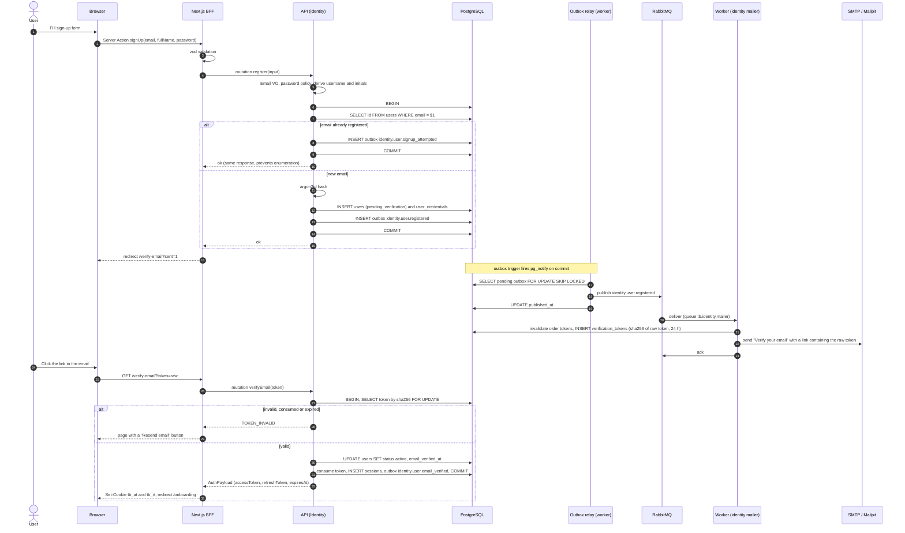

# Sequence 01 · Sign up and verify email

> Index: [07 · Sequence flows](../../07-sequence-flows.md) · Use case: [UC-ACC-01](../use-case/01-account.md#uc-acc-01--sign-up) · States: [User](../state/01-user-account.md), [Verification token](../state/03-verification-token.md)

## Notes

- **The raw token never leaves the worker except inside the email.** The API emits an event, and the worker creates the token, stores only its hash, and sends the link. Nothing secret sits in the outbox or in RabbitMQ.
- Verification signs the user in directly. The link proves control of the inbox.
- "Resend email" → `resendVerification(email)` → `identity.user.verification_requested` → same worker path, rate-limited to 3 per hour.
