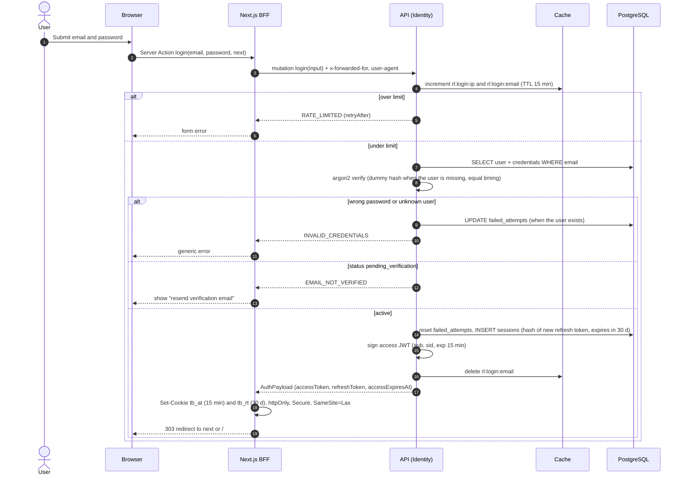

# Sequence 02 · Log in

> Index: [07 · Sequence flows](../../07-sequence-flows.md) · Use case: [UC-ACC-03/04](../use-case/01-account.md#uc-acc-0304--log-in-and-silent-refresh) · State: [Session](../state/02-session.md)

## Notes

- `next` is validated against an allowlist of relative paths (no open redirects).
- `suspended` users get `ACCOUNT_SUSPENDED`. The response for `deleted` users is indistinguishable from unknown ones.
- Account lockout: after 10 failures, `locked_until = now + 15 min`, on top of the rate limit.
