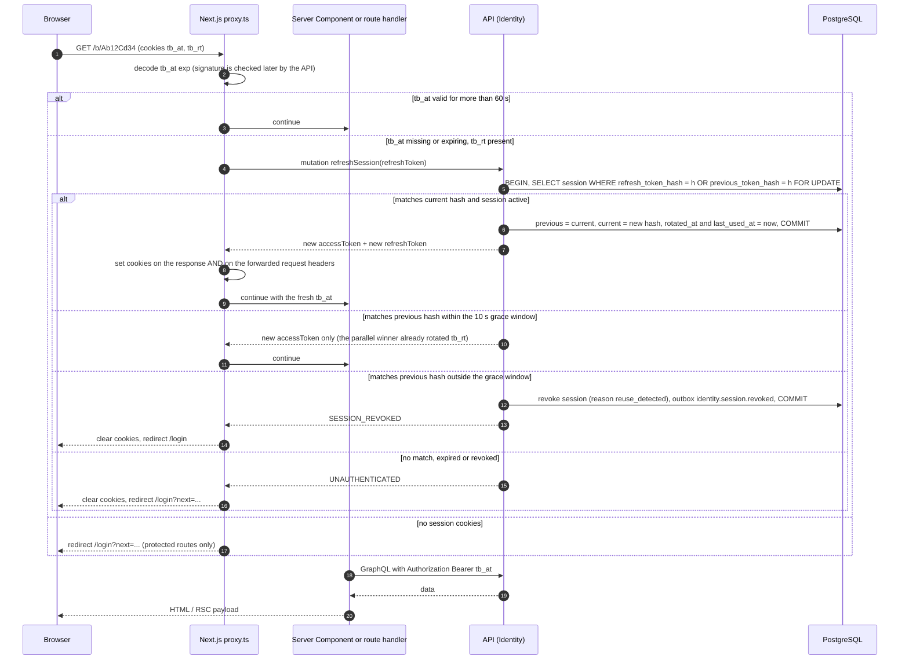

# Sequence 03 · Silent session refresh (refresh-token rotation)

> Index: [07 · Sequence flows](../../07-sequence-flows.md) · State: [Session](../state/02-session.md) · Decision: [ADR-004](../../11-decisions.md#adr-004)

## Notes

- **Why in `proxy.ts`:** Server Components can't set cookies during render. The proxy (Next.js 16's renamed middleware) runs first, so it can rotate tokens and expose the new access token to the same request.
- **Grace window:** two tabs firing at once both send the old refresh token. The first rotates it. The second matches `previous_token_hash` within 10 s and gets only a new access token. The browser already holds the new `tb_rt` from the first response.
- **Reuse detection:** an old refresh token presented later means it was copied, so the whole session is revoked.
- `/api/graphql` and `/api/realtime` share the same refresh helper. Client-side, a `401` from `/api/graphql` triggers one transparent retry after the proxy refreshes.
