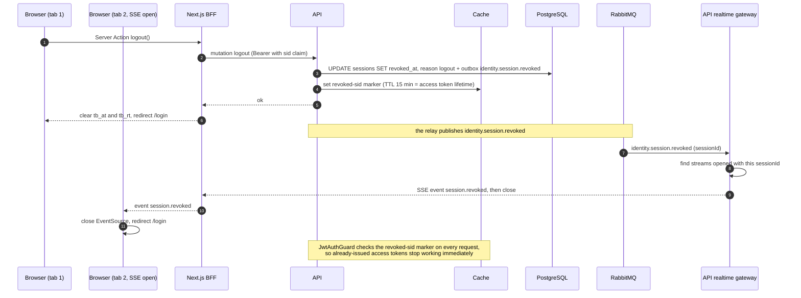

# Sequence 04 · Log out and session revocation

> Index: [07 · Sequence flows](../../07-sequence-flows.md) · State: [Session](../state/02-session.md)

## Notes

- The revoked-sid marker in the cache is what makes revocation immediate. Without it, a stolen access token would live up to 15 min.
- If the cache is down (fail-open), revocation falls back to "at most 15 min". That's an accepted trade-off.
- "Log out of all devices" (P2) revokes every session of the user with the same mechanism.
