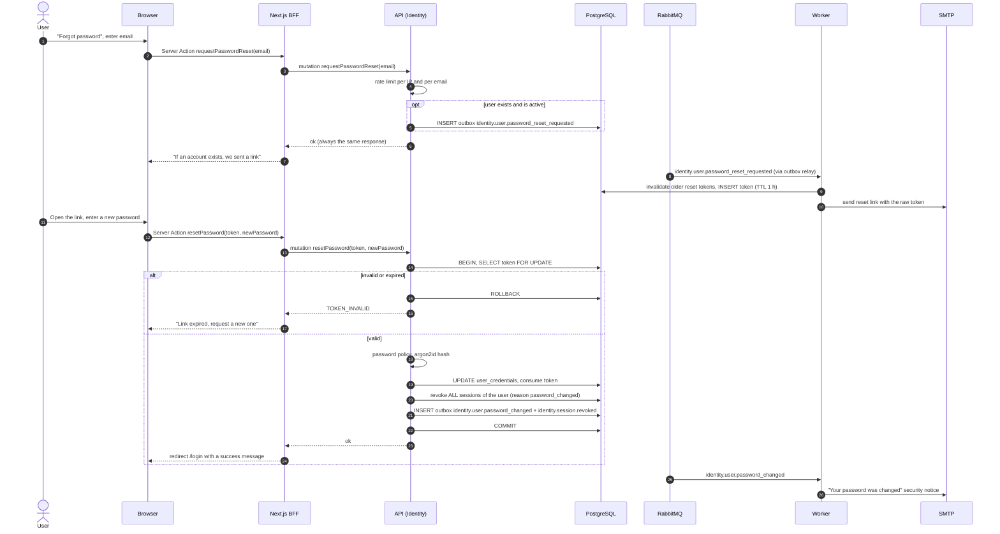

# Sequence 05 · Forgot / reset password

> Index: [07 · Sequence flows](../../07-sequence-flows.md) · Use case: [Account](../use-case/01-account.md) · State: [Verification token](../state/03-verification-token.md)

