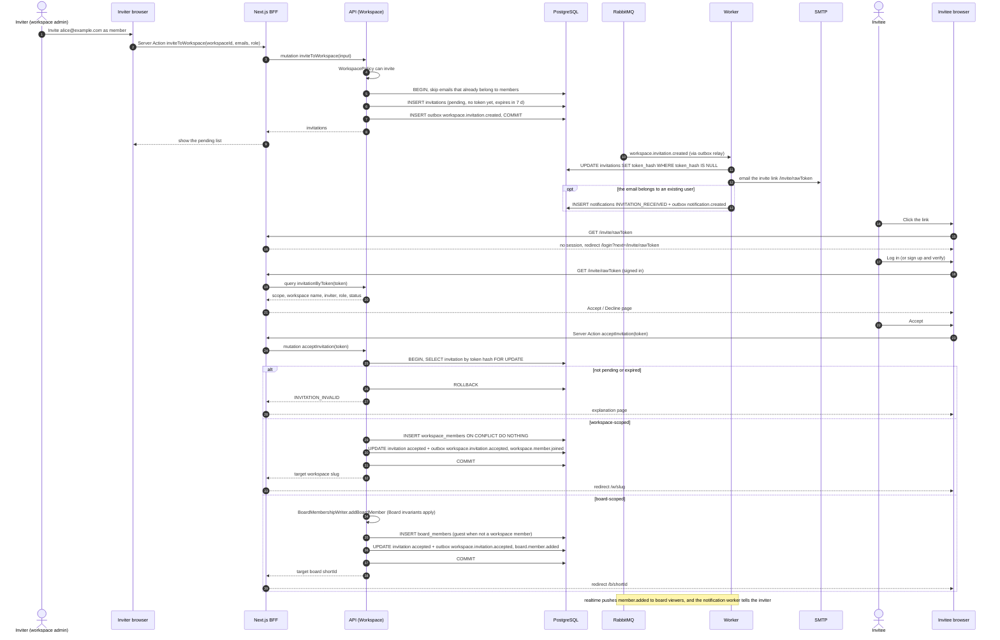

# Sequence 07 · Invite member and accept invitation

> Index: [07 · Sequence flows](../../07-sequence-flows.md) · Use case: [UC-WSP-04/05](../use-case/02-workspace.md#uc-wsp-0405--invite-and-accept) · Activity: [Accept invitation](../activity/02-accept-invitation.md) · State: [Invitation](../state/04-invitation.md)

## Notes

- The token is issued by the worker, like verification tokens, so the raw token never sits in the outbox or queue. **Shareable link** invitations (P2) are the exception: the API returns the link to the inviter directly, because the inviter is authorised to see it.
- "Resend invitation" issues a new token and invalidates the old link.
