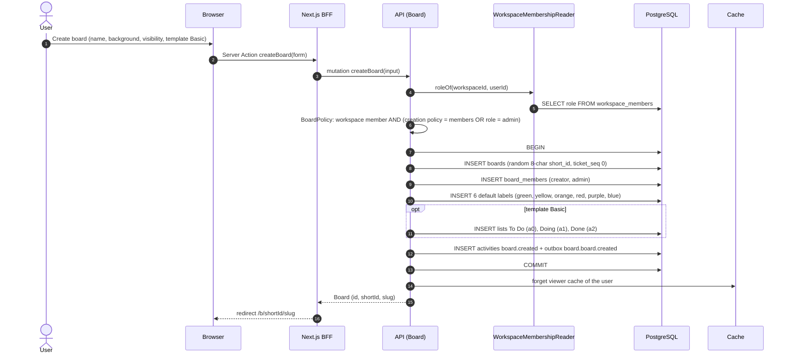

# Sequence 08 · Create board

> Index: [07 · Sequence flows](../../07-sequence-flows.md) · Use case: [UC-BRD-01](../use-case/03-board.md#uc-brd-01--create-board) · State: [Board](../state/06-board.md)

## Notes

- `short_id` is random base62 (62⁸ ≈ 2.2 × 10¹⁴). On the rare unique violation, the handler retries with a new id (max 3).
- The Basic template's list names use the creator's locale ([12 §5](../../12-internationalisation.md#5-what-gets-translated)). After that they're ordinary board data.
