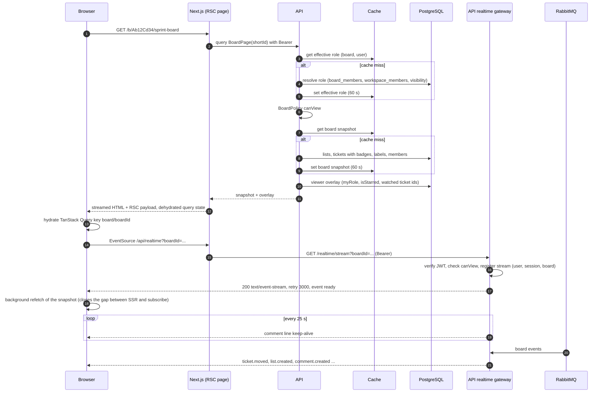

# Sequence 09 · Open board (SSR snapshot, cache-aside, realtime subscribe)

> Index: [07 · Sequence flows](../../07-sequence-flows.md) · Query: [06 · Database §6](../../06-database.md#6-key-queries) · Cache: [Sequence 21](./21-cache-aside-and-invalidation.md) · Realtime: [Sequence 19](./19-sse-connection-lifecycle.md)

## Notes

- **Subscribe, then refetch.** The SSR snapshot was read *before* the stream existed, so events in between could be missed. After `ready`, the client refetches once. Events and refetch are both idempotent thanks to entity `version`s.
- The snapshot is **shared by all viewers** (cached per board). Per-viewer bits (`myRole`, `isStarred`, watched ids) are a separate small query that's never cached with it.
- The ticket modal (`/c/:shortId`) loads `ticket(shortId)` separately: description, checklists, attachments, first page of the timeline.
