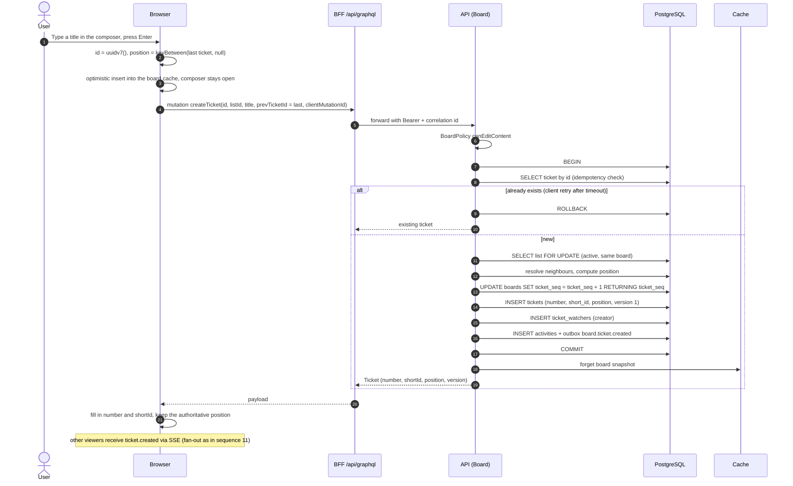

# Sequence 10 · Create ticket (optimistic, idempotent)

> Index: [07 · Sequence flows](../../07-sequence-flows.md) · Use case: [List and ticket](../use-case/04-list-and-ticket.md) · State: [Ticket](../state/08-ticket.md)

## Notes

- **Client-generated UUIDv7** makes creates idempotent and removes temp-id swapping in the UI. The server rejects ids that aren't valid v7 or whose timestamp is more than 5 min off.
- Rapid entry (5 tickets in 2 s) works because each create anchors on the previous optimistic ticket's id. The server resolves `prevTicketId` in order, since creates in one list serialise on the list lock.
