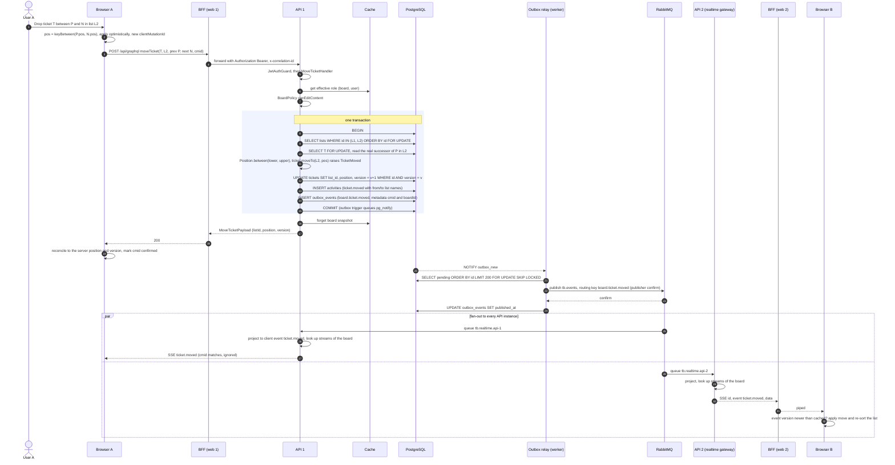

# Sequence 11 · Move ticket (drag and drop) with realtime fan-out

> Index: [07 · Sequence flows](../../07-sequence-flows.md) · Use case: [UC-TKT-04](../use-case/04-list-and-ticket.md#uc-tkt-04--move-ticket-drag-and-drop) · Activity: [Position resolution](../activity/04-move-ticket-position.md) · States: [Drag UI](../state/14-ticket-drag-ui.md), [SSE client](../state/15-sse-client-connection.md) · Architecture: [Realtime fan-out](../architecture/06-realtime-fanout.md)

This is the most important flow in the product.

## Failure branches

| Failure | Behaviour |
|---|---|
| `FORBIDDEN` / `TARGET_LIST_UNAVAILABLE` | Client rolls back the optimistic move and shows a toast. `TARGET_LIST_UNAVAILABLE` also refetches the board |
| `ConcurrencyError` on the ticket row | Handler retries up to 3 times (moves are last-writer-wins on placement) |
| Network error / timeout | Client rolls back. A retry with the same `clientMutationId` is safe |
| Relay or RabbitMQ down | Mutation still succeeds. Other viewers see the change late, once the outbox drains. Clients reconnecting refetch anyway |
| Browser B missed events (sleep, network) | EventSource reconnects → refetch snapshot ([Sequence 19](./19-sse-connection-lifecycle.md)) |

## Latency budget (target p95 < 500 ms A→B)

| Hop | Budget |
|---|---|
| API transaction | 30 ms |
| Commit → NOTIFY → relay publish + confirm | 20 ms |
| RabbitMQ → API instance | 5 ms |
| SSE through BFF → browser | 20 ms + network |
