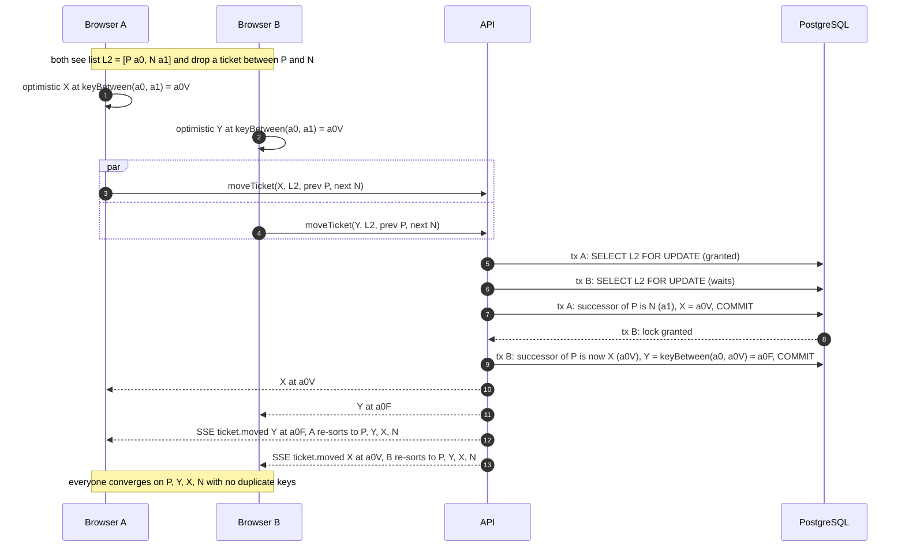

# Sequence 12 · Concurrent moves into the same slot

> Index: [07 · Sequence flows](../../07-sequence-flows.md) · Activity: [Position resolution](../activity/04-move-ticket-position.md) · Ordering: [06 · Database §4](../../06-database.md#4-ordering-fractional-indexing)

## Why it can't produce duplicates

1. The **list row lock** serialises writers per list.
2. The server **ignores the client's `next`** when `prev` is still valid and uses `prev`'s *actual* successor. It honours the user's intent ("right after P") instead of a stale snapshot.
3. The partial unique index `(list_id, position) WHERE archived_at IS NULL` is a last line of defence. A violation would surface as a 500 and alert, never as silent corruption.
