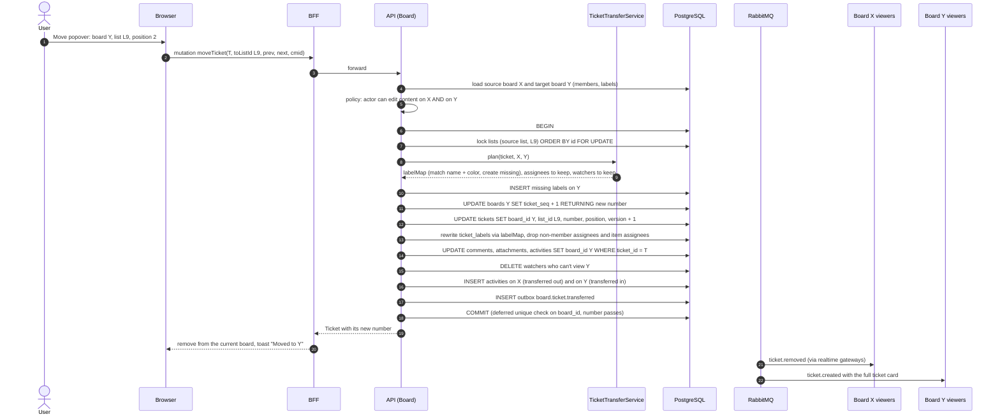

# Sequence 13 · Move ticket to another board

> Index: [07 · Sequence flows](../../07-sequence-flows.md) · Use case: [UC-TKT-05](../use-case/04-list-and-ticket.md#uc-tkt-05--move-ticket-to-another-board) · Class: [TicketTransferService](../class/04-board.md)

## Notes

- The ticket's **short link stays the same**, so old links keep working. Its **number** changes (#42 on X → #7 on Y), as in Trello.
- Moving a whole list to another board (P2) is the same procedure applied to every ticket of the list in one transaction, batched.
