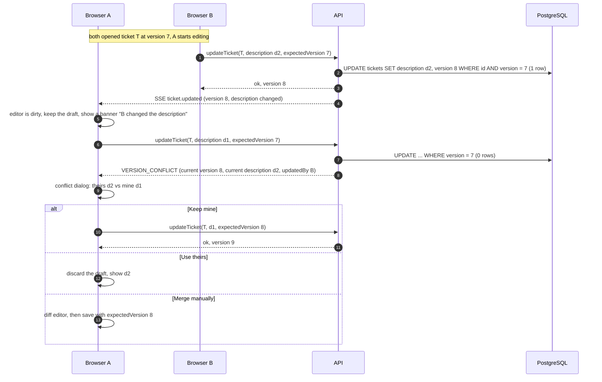

# Sequence 14 · Edit description with conflict detection

> Index: [07 · Sequence flows](../../07-sequence-flows.md) · Use case: [UC-TKT-03](../use-case/04-list-and-ticket.md#uc-tkt-03--edit-title-or-description)

## Notes

- Only **title and description** use `expectedVersion`. Labels, assignees, dates, cover and moves are commutative, last-writer-wins, and retried server-side on version races.
- When the editor is **clean**, an incoming `ticket.updated` just replaces the text. There's no dialog.
