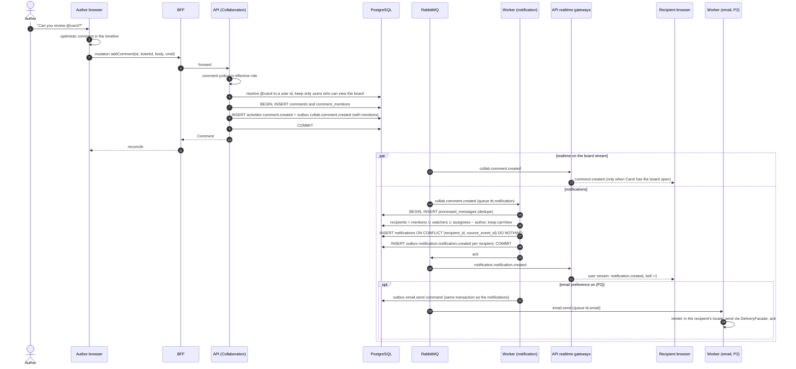

# Sequence 15 · Comment with @mention → realtime + notification (+ email)

> Index: [07 · Sequence flows](../../07-sequence-flows.md) · Use case: [UC-TKT-12](../use-case/05-collaboration.md#uc-tkt-12--comment-with-mention) · Activity: [Fan-out](../activity/05-notification-fanout.md) · State: [Notification](../state/12-notification.md)

## Notes

- Carol's bell updates on **any** page, because every tab holds one SSE stream that always includes the user channel ([Sequence 19](./19-sse-connection-lifecycle.md)).
- Commands such as `email.send` also go through the outbox. The relay routes `*.send` types to the `tb.commands` exchange.
