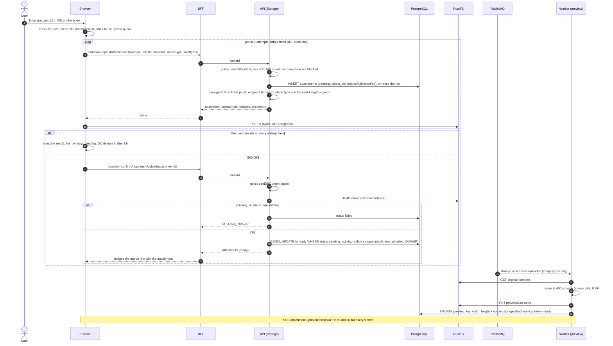

# Sequence 16 · Attachment upload (presigned PUT to RustFS)

> Index: [07 · Sequence flows](../../07-sequence-flows.md) · Use case: [UC-TKT-10](../use-case/05-collaboration.md#uc-tkt-10--upload-attachment) · State: [Attachment](../state/10-attachment.md) · Class: [Storage](../class/06-storage.md) · Design: [13 · File uploads](../../13-file-uploads.md)

## Notes

- **Signing host:** the URL must be signed for the host the **browser** uses (`S3_PUBLIC_ENDPOINT`), not the Docker-internal `rustfs:9000`. That's why the storage adapter has two clients ([class diagram](../class/06-storage.md)).
- **CORS** on RustFS must allow `PUT` from the web origin ([10 · Infrastructure §6](../../10-infrastructure.md#6-object-storage-rustfs)). The fallback is in [13 §9](../../13-file-uploads.md#9-rustfs-and-deployment).
- **Retries reuse the id.** The request mutation is idempotent, so a second call returns the same row and a new URL. That also recovers from an expired URL.
- Files are never served from the API process. Bytes go browser ↔ RustFS directly.
