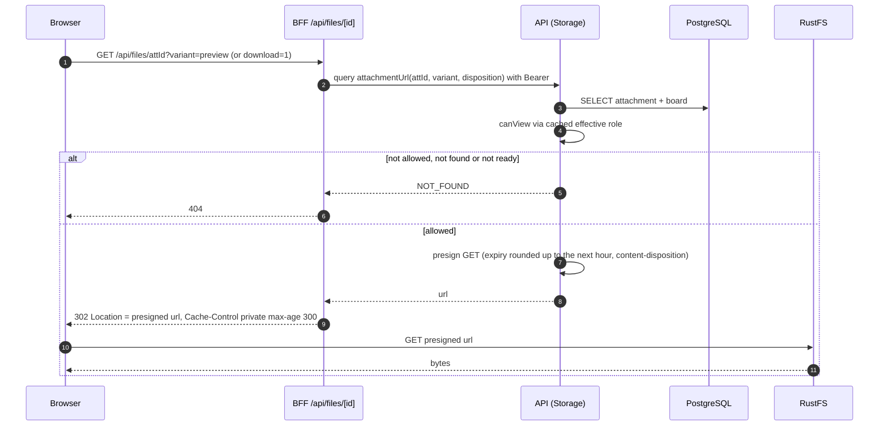

# Sequence 17 · Attachment download / preview (presigned GET)

> Index: [07 · Sequence flows](../../07-sequence-flows.md) · Class: [Storage](../class/06-storage.md)

## Notes

- **Time-bucketed presigning:** rounding the expiry to the hour makes the URL stable for up to an hour, so the browser's HTTP cache serves repeated thumbnails on the board.
- Permission is checked on every redirect request. Revoked users can't fetch new URLs, though an already-issued URL stays valid until it expires (≤ 1 h). That's an accepted trade-off.
- Avatars, workspace logos and board backgrounds live in the **public** bucket and are linked directly. No redirect.
- **Disposition:** the default is `attachment`. Only PNG, JPEG, GIF, WebP and PDF may open inline. The file name comes from `attachments.file_name`, sent as `filename*=UTF-8''…` ([13 §7](../../13-file-uploads.md#7-security)).
