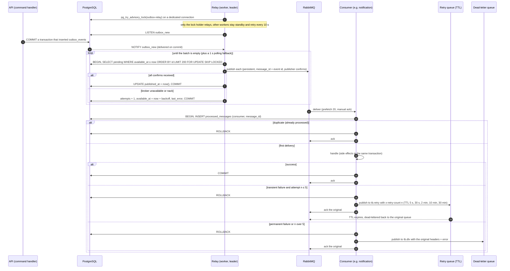

# Sequence 18 · Outbox relay, consumers, retry and dead-letter

> Index: [07 · Sequence flows](../../07-sequence-flows.md) · ERD: [Infrastructure tables](../erd/04-infrastructure-tables.md) · States: [Outbox event](../state/13-outbox-event.md), [Message consumption](../state/16-message-consumption.md) · Topology: [RabbitMQ](../architecture/09-rabbitmq-topology.md)

## Guarantees

| Property | How |
|---|---|
| **No lost events** | Event row commits atomically with the state change. Relay retries until confirmed |
| **At-least-once delivery** | A crash between publish and `published_at` update causes a republish |
| **Exactly-once effects** | Consumers dedupe on `(consumer, message_id)` inside their own transaction |
| **Order** | Single relay leader publishes in `id` (UUIDv7) order. Consumers with prefetch > 1 may reorder, so consumers that care (realtime) use entity `version` |
| **Poison messages** | Go to `tb.dlq.<queue>` after 5 retries. Alert on DLQ depth > 0. Replay via an admin script |
